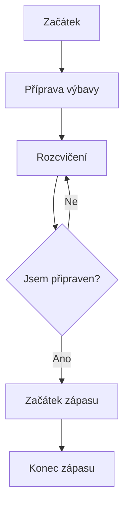

# Fotbalová příručka přežití

## Jak přežít fotbalový zápas a užít si ho naplno

Fotbal je jeden z nejpopulárnějších sportů na světě. Tato příručka ti pomůže pochopit základní pravidla, připravit se na zápas a užít si fotbal jako hráč nebo fanoušek.

*Moje osobní příručka pro každého, kdo miluje fotbal.*

## 1. Základní pravidla fotbalu

Fotbal hrají dva týmy. Každý tým má na hřišti 11 hráčů včetně brankáře.

### Co musíš vědět

- Zápas trvá obvykle 90 minut.
- Cílem je vstřelit více gólů než soupeř.
- Hráči nesmí úmyslně hrát rukou, kromě brankáře ve vlastním pokutovém území.
- Za fauly může rozhodčí udělit žlutou nebo červenou kartu.

**Nejdůležitější pravidlo:** Hraj fér a respektuj soupeře.

## 2. Jak se připravit na zápas

Před zápasem je důležité být připravený fyzicky i psychicky.

### Co si vzít s sebou

1. Fotbalové kopačky.
2. Chrániče holení.
3. Dres a trenýrky.
4. Láhev s vodou.
5. Dobrou náladu.

*Nezapomeň se pořádně rozcvičit!*

~~Rozcvičení není potřeba, když se cítíš jako Messi.~~

## 3. Fotbalová výbava


*Fotbalový míč je základní vybavení každého hráče.*

### Přehled výbavy

| Vybavení | K čemu slouží | Důležitost |
|---|---|---|
| Míč | Hraní fotbalu | Velmi vysoká |
| Kopačky | Lepší pohyb na hřišti | Vysoká |
| Chrániče | Ochrana nohou | Vysoká |
| Dres | Rozlišení týmů | Střední |

## 4. Užitečné fotbalové odkazy

Pokud chceš sledovat fotbalové výsledky a novinky, doporučuji:

- [Oficiální stránky FIFA](https://www.fifa.com/) – informace o světovém fotbale.
- [Oficiální stránky UEFA](https://www.uefa.com/) – evropské soutěže a výsledky.

## 5. Digitální laboratoř

Pomocí Pythonu můžeme jednoduše zjistit, kolik gólů tým vstřelil.

```python
tym = "Real Madrid"
goly = 3

print(f"Tým {tym} vstřelil {goly} góly.")
```

Tento program vypíše název týmu a počet vstřelených gólů.

## 6. Fotbalový úkolovník

Tento seznam můžeš použít jako kontrolu před zápasem.

- [x] Připravit fotbalovou výbavu
- [x] Zkontrolovat kopačky
- [ ] Naplnit láhev s vodou
- [ ] Rozcvičit se
- [ ] Užít si zápas

## 7. Matematika ve fotbale

Fotbal lze popsat také matematicky.

```math
\text{Úspěšnost střelby} = \frac{\text{Počet gólů}}{\text{Počet střel}} \times 100
```

Například pokud hráč vystřelí 10krát a vstřelí 2 góly, jeho úspěšnost střelby je 20 %.

## 8. Jak probíhá příprava na zápas



## Závěr

Fotbal není jen o gólech a vítězstvích. Je také o týmové spolupráci, respektu a radosti ze hry.

**Užívej si fotbal, hraj fér a nikdy se nevzdávej!**

*Fotbal spojuje lidi po celém světě.*
